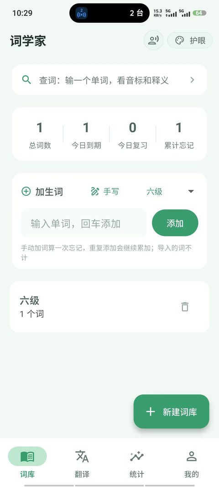
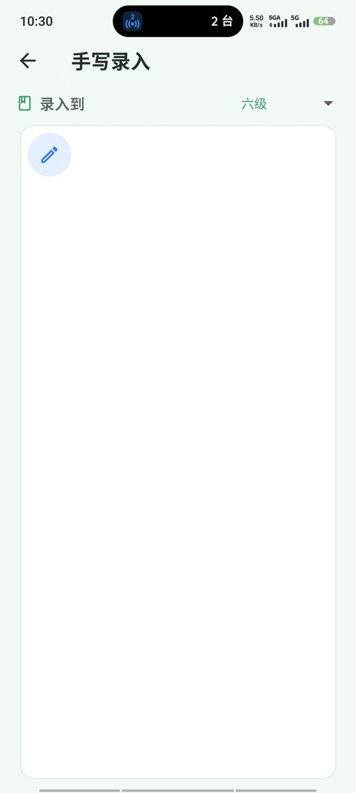
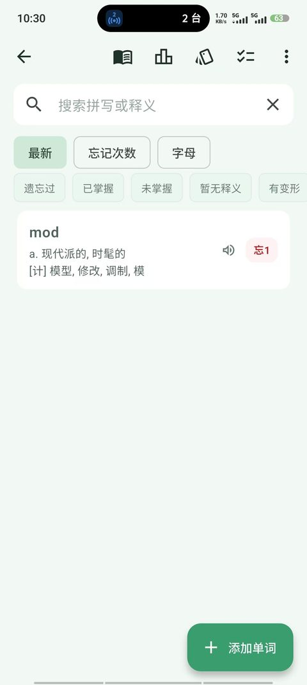
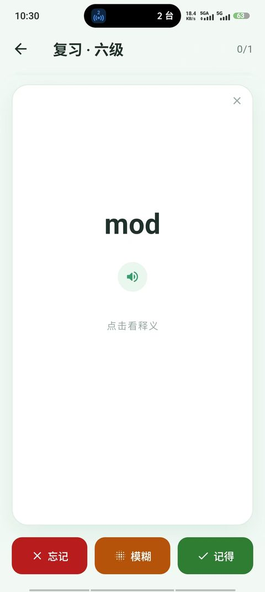
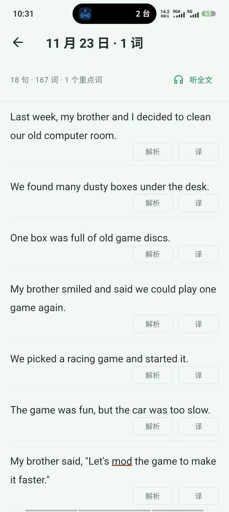
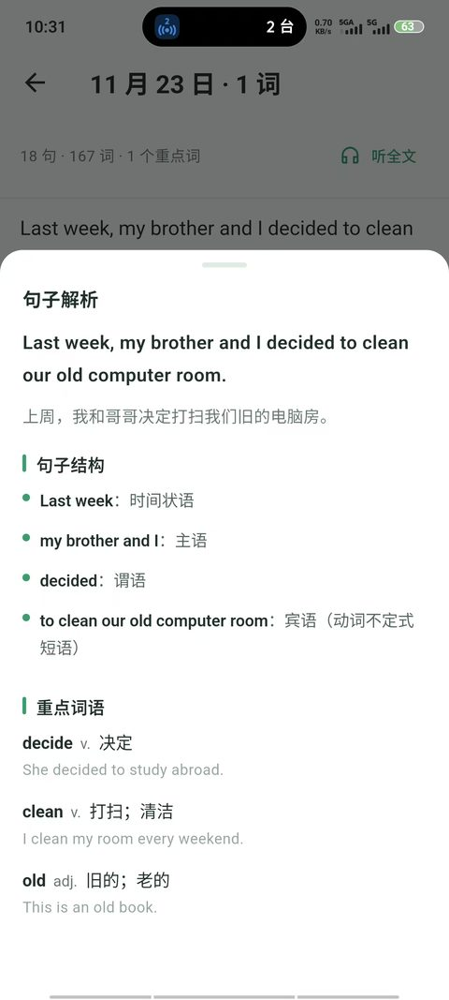
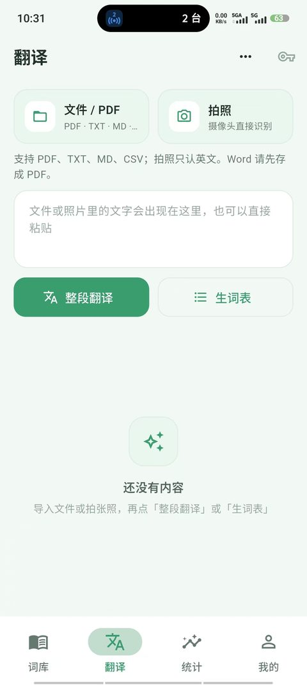
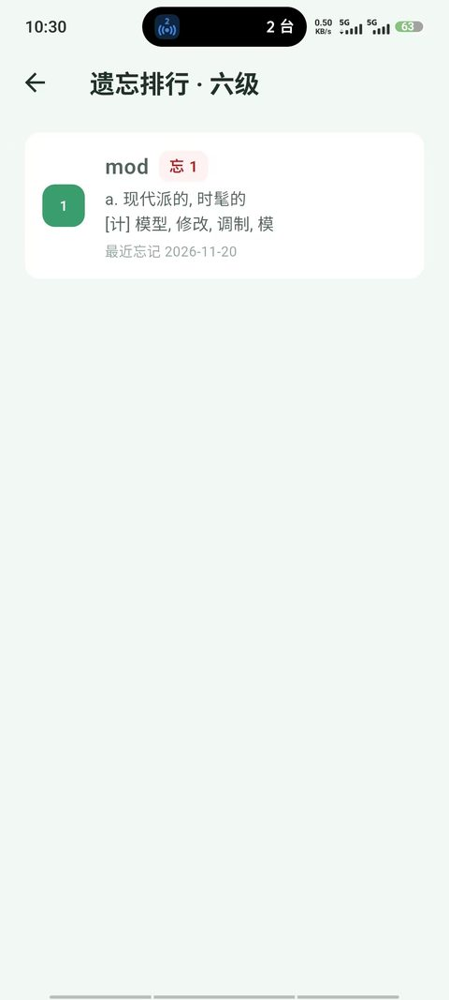
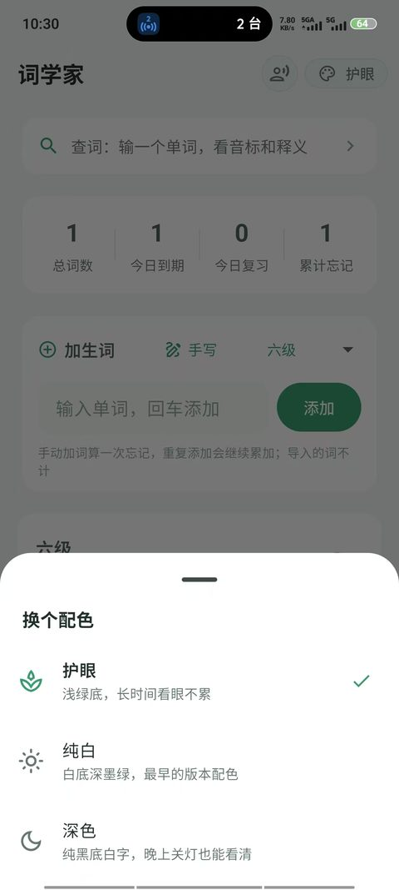

# 词学家（vocab_app）

  

**本项目为开源版本**，代码以 MIT 许可证发布，可自由使用、修改与再分发。

一款本地优先的英语生词积累与精读 App，Android 端，Flutter 开发。

看到生词，快速录入，自动配释义，按节奏复习。词库、生词、复习记录、生成的文章与内置词典全部存放在设备本地，不需要账号，不上云。

当前版本：1.7.31（构建 82），开源版本

## 开源版本说明

本仓库面向学习与二次开发，与准备上架商店的分发版本存在以下差别：

- 使用 debug 签名，仅供自行编译安装测试；正式分发包请自行生成 keystore 并替换 `signingConfig`
- 不内置任何第三方密钥，联网增强功能需使用者自填 DeepSeek 与有道密钥
- 内置词典为 ECDICT 数据，按 MIT 许可随仓库分发
- 未包含应用商店上架所需的隐私政策页、备案材料与合规文案

## 功能

- 手写录入：多笔迹书写、按笔迹范围擦除、三档笔粗细与多色笔迹，停笔后自动识别候选词
- 候选预览：每个候选下方直接显示音标与释义，勾选即批量入库，识别不准的可在输入框手动补齐
- 拍照取词：书页、试卷、板书拍照后整段识别英文，过滤停用词后拆成候选
- 多词库管理：可按题材或来源分库，词条互不干扰
- 精读文章：接入大模型按当前词库生成同主题短文，可对句子做结构拆解与逐句翻译
- 固定间隔复习：忘记 1 天、模糊 3 天、记得 7 天后重新出现，可标已掌握
- 统计反馈：复习概览、周统计、遗忘次数排行
- 离线优先：内置 61595 条词条的只读词典，读音提供端侧语音合成

## 截图

Android 真机截图，版本 1.7.31，护眼配色。

| 词库首页 | 手写录入 | 词库详情 |
| --- | --- | --- |
|  |  |  |
| 四项统计、加生词入口、多词库并列 | 笔迹画板，可切橡皮、笔粗与配色 | 排序筛选，词条标出忘记次数 |

| 复习卡片 | 精读文章 | 句子解析 |
| --- | --- | --- |
|  |  |  |
| 忘记、模糊、记得三档，答完按间隔重排 | 按词库生成短文，可逐句翻译与朗读 | 拆句子结构、给重点词与例句 |

| 整段翻译 | 遗忘排行 | 换配色 |
| --- | --- | --- |
|  |  |  |
| 导入 PDF 或拍照识别后整段翻译、提取生词 | 按忘记次数排序，方便回头啃硬词 | 护眼、纯白、深色三套配色 |

## 技术栈

- Flutter（stable 通道），Dart SDK >= 3.5.0
- 数据层：sqflite，本地 SQLite
- 识别：Google ML Kit 文字识别与数字墨水识别（端侧模型，首次按需下载）
- 语音：flutter_tts 调用系统语音；sherpa-onnx 提供离线语音合成
- 文件：file_picker、image_picker、archive、syncfusion_flutter_pdf

## 构建

环境要求：Flutter stable、JDK 17、Android SDK（含 build-tools 35）、arm64 设备或模拟器。

```bash
flutter pub get
flutter build apk --release --target-platform android-arm64
```

产物在 `build/app/outputs/flutter-apk/app-release.apk`。

说明：

- 安装包只保留 arm64 一套原生库，x86 与 armeabi-v7a 已在 `android/app/build.gradle` 中排除
- 仓库中的 `android/app/build.gradle` 仍使用 debug 签名，仅为方便自行安装测试。正式分发请自行生成 keystore 并替换 `signingConfig`，不要提交 keystore 或 `key.properties`

## 密钥与联网功能

精读文章与翻译属于可选联网增强，需要使用者自备密钥，App 内填写：

- DeepSeek 密钥：用于生成文章与句子解析
- 有道 appKey 与 appSecret：用于逐句翻译

密钥经加密后存放于本机私有库，不写入安装包、不随普通数据导出。仓库内没有任何硬编码密钥。

不填密钥时，词库管理、手写录入、拍照取词、离线词典与复习功能完全可用。

## 权限与隐私

- 仅申请联网权限
- 拍照走系统相机调用，不申请相机权限
- 不索取通讯录、位置、短信、麦克风等权限
- 关闭系统备份（`allowBackup=false`），词库不会被系统自动备份到云端
- 无账号体系，卸载即清除全部数据

## 内置词典

`assets/dict.db` 由 ECDICT 数据经 `tools/build_dict.py` 生成，共 61595 条词条，以只读方式打开。数据来源与许可见 `THIRD_PARTY_NOTICES.md`。

如需自建词库，准备 ECDICT 的 `ecdict_top.csv`（可选 `ecdict_full.csv`）后运行：

```bash
python tools/build_dict.py
```

## 契约测试

`tool/` 下是一组针对关键行为的断言脚本，逐条锁定界面结构与数据处理规则，例如：

```bash
python tool/verify_handwriting.py
python tool/verify_import_limit.py
python tool/verify_p0_contract.py
```

全部脚本以源码文本为检查对象，不依赖真机，可在 CI 中直接运行。

## 已知限制

- 仅 arm64，未适配 x86 模拟器
- 数字墨水识别首次使用需联网下载模型
- 复习间隔为固定档位，非自适应算法

## 许可证

代码以 MIT 许可证发布，见 `LICENSE`。第三方组件与数据各自保留原许可，见 `THIRD_PARTY_NOTICES.md`。
